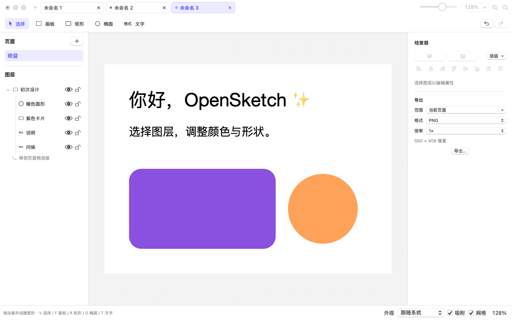

# OpenSketch

面向 macOS 的开源矢量 UI 设计软件。当前版本为 **0.1.0 原生初始原型**，重点验证编辑模型、文字、持久化、图层组织和基础导出能力。

## 界面预览



## 构建与运行

需要 macOS 15+、支持 Swift 6 的 Xcode/系统工具链，无第三方包依赖。在仓库根目录执行：

```sh
swift test
scripts/build.sh release
plutil -lint build/OpenSketch.app/Contents/Info.plist
codesign --verify --deep --strict build/OpenSketch.app
open build/OpenSketch.app
```

`scripts/build.sh debug` 构建调试包；产物固定写入 `build/OpenSketch.app`，使用本地 ad-hoc 签名，不会自动安装到 `/Applications`。更多构建、验收和限制见[项目完成进度](docs/development/2026-11-09-project-status.md)。

## 当前能力

- 原生 AppKit 画布、SwiftUI 面板、原生图层树，以及单窗口多文档标签。
- 页面、画板、编组、矩形、椭圆、文字和路径模型；选择、框选、移动、缩放、编组、排序、对齐、分布和容器归属调整。
- 图层树整行选择、多选、拖拽排序、拖入/移出容器、原位重命名、锁定与隐藏。
- 检查器参数编辑、撤销/重做、画布缩放/平移/网格、吸附、中文和 emoji 文字编辑。
- `.opensketch` 目录包保存与重开、PNG/PDF 导出，以及亮色/暗色和中英文设置。

当前版本是可编辑原型，完整矢量创作能力仍在持续建设中。

## 开发路线

下一阶段进入 **M2 矢量 Alpha**：钢笔与节点编辑、布尔运算、渐变/描边/效果、SVG 工作流和矢量几何稳定性。

插件平台从 M2 开始设计并分阶段交付：

- 内置格式插件：OpenSketch、SVG、PNG；后续增加 JPG、PDF 等格式插件。
- 内置 MCP/AI 原生操作插件：通过结构化命令、事务、预览、撤销和权限边界操作文档。
- 设备同步预览插件：连接设备端 App 或显示后端，实时同步设计并支持预览/演示。
- HTML 交互与素材包插件：导出可交互 HTML、资源文件、字体/图片清单和开发交付包。

完整的阶段、插件边界、API 方向、交付顺序和验收标准见[开发路线与插件平台规划](docs/roadmap.md)。

## 文档

- [项目完成进度与验收状态](docs/development/2026-11-09-project-status.md)
- [开发路线与插件平台规划](docs/roadmap.md)
- [核心 API 与文件格式](docs/development/core-api.md)
- [源码结构](docs/source-structure.md)
- [历史验收记录](docs/development/2026-11-06-prototype-acceptance.md)
- [初期可行性评估](docs/assessment/2026-11-05-feasibility.md)

## 已知边界

尚未支持完整钢笔/节点编辑、布尔运算、完整 SVG 互操作、组件实例、Stack/约束、自动恢复、实时协作和生产签名。当前导出能力仍由应用内流程提供，插件化导出、MCP/AI、设备同步预览、HTML 交互和素材包属于后续规划。

项目采用 MIT License；来源、系统依赖和商标说明见 [THIRD_PARTY_NOTICES.md](THIRD_PARTY_NOTICES.md)。
