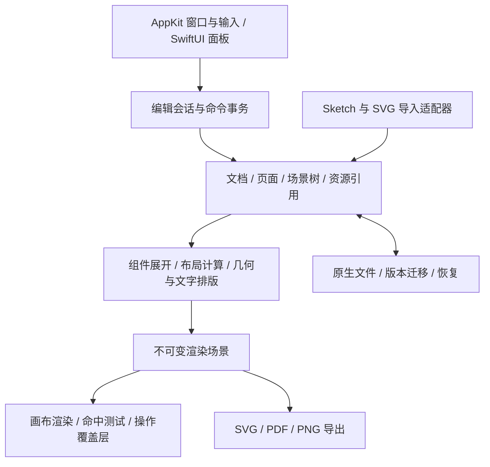

# openSketch 可行性评估

日期：2026-11-05。状态：评估建议，尚未实施。

## 1. 结论与目标

技术上可行。推荐以独立项目实现 macOS 原生矢量 UI 编辑器，选择性移植 Compositor 的通用交互与基础设施。Compositor 的像素文档和合成链路不适合作为新产品的核心模型；直接 fork 后持续扩展会使组件、布局、矢量导出和文件兼容长期受其约束。

用户已确认：项目名为 **openSketch**；macOS 原生优先，跨平台留待后续；对标/替代本机 `/Applications/Sketch.app`。因此，“能画矩形和文字”只算技术原型。能承担真实 UI 项目还需要路径、画框、文本、组件、布局、资源导出和已有设计稿迁移。

替代范围分为两层：先实现本地个人 UI 设计工作流；团队实时协作、云资源库、权限管理和插件生态作为后续独立项目。阶段划分是本评估的建议，不是用户已接受的功能缩减。

## 2. 当前证据

| 对象 | 本次已核实 | 证据边界 |
|---|---|---|
| Sketch | 2026.3.1 / 234013，最低 macOS 15；实际打开编辑器、新建画框、转换 Stack、本地保存 | 尚未完成复杂组件、路径、字体、原型和性能对比 |
| Sketch 文件 | 自建样本为 ZIP + JSON，格式号 196；Stack 使用 `group` 与 `MSImmutableFlexGroupLayout` | 一个简单样本不代表全部版本和对象类型 |
| Compositor | 本机提交 `f6cd2f0`；MIT；原生 SwiftUI/AppKit；Swift 5 语言模式；部署目标 26.0 | 本次源码评估未重新构建或执行其测试 |
| 开发机 | arm64，macOS 27.2，Xcode 27.1，Apple Swift 6.4 | 不等于已验证 macOS 15 或 Intel 运行 |
| openSketch | 已建立独立 Git 仓库，只有评估材料 | 没有可运行应用、性能结果或兼容性实现 |

完整源码证据见 [复用审计](compositor-audit.md)，实际 GUI 和样本记录见 [Sketch 实测](sketch-observations.md)。

## 3. 三条路线

| 路线 | 收益 | 主要代价 | 判断 |
|---|---|---|---|
| **独立 Swift 核心，复用 Compositor 的局部能力** | 原生体验；模型直接围绕 UI 设计；可逐模块检验 | 要新建场景树、矢量编辑、组件和布局 | **推荐** |
| fork Compositor，逐步增加矢量能力 | 很快获得可启动应用和现成面板 | 核心按位图组织；大量照片工具需要剥离；保存和导出要重构 | 适合探索演示，不适合作为长期主线 |
| 立即建设跨平台核心与渲染器，再接原生外壳 | 未来平台共享空间较大 | 桥接、文本、输入法、构建与调试成本提前发生 | 与已确认的原生优先策略不匹配，暂缓 |

不为复用率给出百分比：模块可借鉴不等于文件可直接移植。Compositor 的 Editor/UI 目录划分目前仍在同一应用模块内，抽取时必须处理依赖。

## 4. 建议架构

建议 Swift 6 语言模式，AppKit 承担文档窗口、输入、文本编辑与画布，SwiftUI 承担面板、设置和常规控件。初步以 **macOS 15+、Apple silicon 优先**为目标，与本机 Sketch 的最低系统要求对齐；这是待原型验证的目标。移植的 macOS 26 专用控件需要替换或加可用性分支。

### 模型和编辑

- `Document` 持有页面、资源、共享样式和组件定义；`Page` 是可平移工作区，包含多个 Frame。
- 节点以稳定 ID 和明确的子节点顺序组织。内容类型区分 Frame、Group、Path、Text、Image、ComponentDefinition、ComponentInstance、BooleanGroup。
- 路径保存锚点、控制柄、闭合状态和填充规则；图片是资源引用。矢量语义是持久化真值，预览位图只是可丢弃缓存。
- 局部变换、父子变换和视图变换分开；命中、吸附、控制点与导出共用坐标转换。模型里的 Double 坐标和尺寸不依赖屏幕倍率。
- 编辑统一经过命令事务。一次拖动或一段连续文字编辑形成一次撤销；取消恢复事务前状态。选择、悬停和视口状态与持久化内容分离。
- 小型原型可用不可变值快照；进入大文档阶段改用节点变更集与资源共享。避免每次鼠标移动复制整份文档。

初期可划分 Model、Editing、Rendering、Persistence、App 五个清晰边界，不急于拆成许多包。模型不依赖 SwiftUI/AppKit 对象；未来跨平台可复用序列化规范和测试用例，原生 UI/文字/渲染仍需平台适配。

### 渲染、路径和文字

先用自定义 NSView + Core Graphics 验证正确性，按可见区域遍历、缓存路径与文本布局，分离选择覆盖层。按实测结果增加分块缓存、空间索引或 Metal 后端。不能因 Compositor 使用 Metal 就认为其位图纹理渲染器已解决矢量渲染。

Core Graphics 提供 Bézier 路径及并、交、差、异或 API，可先实现几何后端。非破坏式布尔节点还要保留操作数和运算树，处理退化路径、孔洞、填充规则及撤销；系统 API 并不提供完整编辑语义。[Apple CGPath](https://developer.apple.com/documentation/coregraphics/cgpath)

文字编辑使用 NSTextView 与输入法。建立统一的测量和排版服务，在 TextKit/Core Text 原型中验证屏幕、选择框和导出的行断点一致性，再确定具体实现。中英混排、组合字符、emoji、缺失字体和字体回退必须进入早期测试；不能以“文字转成图片后看起来正确”作为验收。

### 组件和布局

组件采用定义与实例引用，覆盖值以稳定的子节点 ID 路径定位；不以名称或临时数组下标定位。显式处理嵌套、循环引用、主组件变更与失效覆盖。

Frame 同时承担局部坐标系、裁剪与布局容器。第一批布局支持横/纵 Stack、间距、四边 padding、对齐、Fixed/Fit/Fill 和基础 pinning；后续再扩展换行、min/max、绝对定位子项和隐藏项占位。布局结果与作者输入分开保存，明确 Fit 父项与 Fill 子项冲突时的计算规则。[Sketch Stack Layout](https://www.sketch.com/docs/designing/stack-layout/)

### 文件和兼容

自有版本化文件包保存 manifest、页面 JSON、资源及可选预览。扩展名在正式格式设计时确定，不把 `.sketch` 直接声明为原生格式。保存从一致性快照生成临时包，校验完成后原子替换；记录保存修订，避免后台保存错误地清除之后编辑产生的脏标记。自动保存、崩溃恢复和版本迁移需单独验证。

`.sketch` 官方格式是 ZIP 中的 JSON 和资源，但解析成功不代表视觉和编辑语义相容。[官方文件格式](https://developer.sketch.com/file-format/)

兼容实现要尽早用样本驱动，同时分级交付：

1. 读元信息、页面和预览，识别版本，产生支持性报告。
2. 导入可编辑基础对象、变换、裁剪、文字和样式，记录不支持项。
3. 导入组件覆盖、共享样式和布局，逐项验证编辑后行为。
4. 最后评估写回；写入新文件，并明确支持版本和损失，不承诺无损往返。

未知节点可保留源数据作为兼容附件并标为未支持；不能声称“保留原始 JSON”即可在重新排版、重新生成 ID 后无损写回。没有可用的节点预览时，不以整页预览伪装成已正确渲染的单个节点。首次迁移保留源文件。

SVG 首先覆盖 path、基本形状、分组、transform、fill/stroke、渐变和 clip；文本、filter、外部引用按显式支持表处理。PDF 首先支持导出和作为参考素材放置，任意 PDF 对象还原为可编辑层不是首版目标。Core Graphics 可用于路径绘制与 PDF 输出。[Apple Core Graphics](https://developer.apple.com/documentation/coregraphics)

## 5. 替代里程碑与投入

以下是工程判断，不是已测量工期。假设 **2 名熟悉 macOS/图形的全职工程师，另有兼职设计与测试支持**；阶段工期为增量，包含基本集成和回归，不含云协作。实际节奏在 M0 后重估。

| 阶段 | 建议增量 | 交付和退出条件 |
|---|---|---|
| M0 风险原型 | 2–3 周 | 矢量模型、嵌套变换、中英文排版、保存重开；识别 Sketch 196 样本；形成实测性能基线 |
| M1 编辑基础 | 6–10 周 | 页面与多画框、基本对象、选择/变换/吸附、图层树、属性面板、撤销、原生保存与 PNG 导出 |
| M2 矢量 Alpha | 6–10 周 | 钢笔与节点编辑、布尔运算、渐变/描边/阴影、SVG/PDF 导出；可完成一个小型界面设计 |
| M3 UI 设计 Beta | 8–12 周 | 组件实例/覆盖、共享样式、Stack/约束、切片/倍率导出；真实 UI 页面工作流通过验收 |
| M4 迁移与稳定性 | 8–16 周 | Sketch 可编辑导入扩展、错误报告、恢复、大文档优化、签名发布；约定项目集可迁移使用 |

粗略累积：矢量 Alpha 约 3.5–6 个月；支持日常 UI 工作流的 Beta 约 5.5–9 个月；迁移稳定版约 8–13 个月。按两人连续投入约 16–26 人月至 M4。范围增长、复杂字体和兼容问题可能使结果超出区间；单人无法简单按同样日历完成。AI 能辅助实现和回归，不代替交互与兼容验收。

“完整替代 Sketch 全部能力”还包含原型、外部库同步、开发交付、插件和实时协作，不能从上述估算推出承诺。应在本地设计 Beta 后分开评估。

## 6. 高风险点与验收门槛

| 风险 | 早期验证方式 | 对决策的影响 |
|---|---|---|
| 文字排版偏差 | 中英文、emoji、字体回退、自动尺寸与固定框，比较基线和换行 | 未稳定前不扩大文本功能面 |
| 变换/命中不一致 | 多层旋转、翻转、裁剪、缩放时点击边界与节点拖动 | 先统一坐标模型再做复杂工具 |
| 布尔运算退化 | 相切、自交、细长路径、孔洞和不同填充规则 | 保留操作树；增加几何回归样本 |
| 组件与布局耦合 | 嵌套实例、覆盖文字变长、父容器尺寸变化 | 在 M0 固定身份与布局数据边界 |
| 文件兼容 | 合成样本 + 有代表性的实际项目；像素、结构、编辑行为三类比较 | 以版本/特性声明支持，避免笼统称兼容 |
| 大文档卡顿 | 1k/10k 节点场景，标注可见节点数、图片/文字比例、设备与缩放 | 基准证明需要后再投入 GPU/索引优化 |
| 文件丢失 | 保存中断、损坏包、版本迁移、撤销至保存点、重复打开 | 文件可靠性是 Beta 的硬门槛 |
| 本地化和辅助功能 | 动态占位符、原生菜单、输入法、焦点、AX 标签与命令 ID | 从基础阶段建立契约，避免后补影响模型 |

建议性能目标：在固定 Apple silicon 设备上，1,000 个简单可见节点的平移/缩放以 60 Hz 为目标，记录 p95 帧耗时；10,000 总节点另测可见范围裁剪和选择延迟。**这些是待验证目标，不是性能结论**，阴影、图片和复杂文本分别计量。

首个真实验收用例建议为：三页移动端 UI，共享颜色/文字样式，带图标路径、按钮组件和列表 Stack；更改按钮文字、改变画框宽度后布局合理；保存重开仍可编辑；导出资源与设计一致。迁移验收另选一个真实 Sketch 项目，不用单个空画框代表迁移成功。

## 7. 本阶段完成范围与下一步

本次完成源码审查、官方资料核查、本机基础 GUI 操作与一个文件样本解析，建立了评估仓库。未修改 Compositor 源码、未移植应用功能、未安装 openSketch、未运行应用构建或基准测试，也未发布远程仓库。

建议下一阶段仅启动 M0，并先形成可审阅的详细设计：节点/事务模型、坐标规范、文本原型、文件 schema 和 Sketch 196 最小样本集。M0 达到退出条件后，再确定 M1 的具体实现任务。
